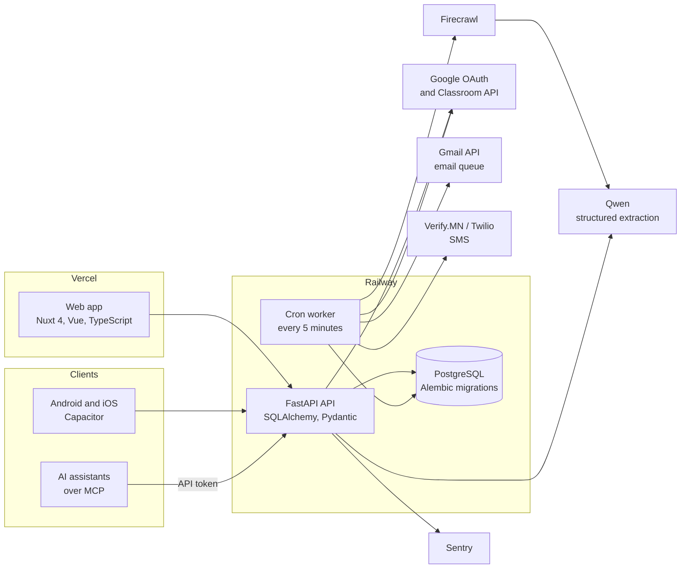

# Primis EduCare portal

The web portal my family's test-prep center in Ulaanbaatar, Mongolia uses to run its IELTS and SAT classes, replacing paper and Excel across three branches. Students, parents, teachers and admins each have their own view.

**Live:** [primiseducare.com](https://primiseducare.com)
**Code:** private, because the portal stores data about children and their families. I'm happy to share it with interviewers or walk through it on a call: [turbileg@student.ubc.ca](mailto:turbileg@student.ubc.ca).

I'm the only engineer. I started this version on 18 September 2026. As of November 2026 it has 16 students in 5 classes, 3 teachers and 2 admins.

## What it does

- **Courses and enrollment.** Admins and teachers create courses, enroll students and track payment deadlines. Each course gets its own Google Classroom class, and enrolled students and teachers are invited automatically.
- **Attendance.** The teacher shows a QR code that changes every 30 seconds, and students check in by scanning it.
- **Parents.** A parent links to their child by scanning a short-lived code from the child's screen. Parents get email (and SMS where it is switched on) about absences, excuse decisions, payments coming due and confirmed, and trials about to end.
- **Scholarships.** A board of scholarship opportunities that admins keep up to date with help from an AI "radar" (below).
- **Personal-statement coach.** A paid feature that gives students rubric-based feedback on their essays.
- **Mobile builds.** Android and iOS builds of the same Nuxt app via Capacitor.
- **Two languages.** Mongolian and English throughout, checked in CI so no text is missing in either.

## Architecture

The cron worker sends queued emails and texts, queues payment and scholarship reminders, activates Google Classroom classes once Google reports them ready, and runs the scholarship radar.

## Design decisions I can explain

**Email that doesn't go out twice from two workers.** Messages wait in a PostgreSQL table. A worker locks each row with `SELECT ... FOR UPDATE` until the send is recorded, so two overlapping cron runs can't send the same message at the same time. It is still at-least-once, not exactly-once: if the process crashes after Gmail accepts a message but before the result is saved, that message can be sent again. Daily caps keep the account under Gmail's sending limits. Tests run two real PostgreSQL connections against each other to prove the locking.

**Rate limits that count the right person.** Behind Railway's proxy every request seems to come from the proxy. The limiter reads `X-Forwarded-For`, but only trusts the number of proxy hops it is configured for, because the left-most entries are whatever the client typed.

**An AI feature that can't publish on its own.** The scholarship radar fetches official scholarship pages with Firecrawl. If a page hasn't changed it stops there, with no model call. Otherwise Qwen extracts the fields into the same Pydantic schema an admin form uses. The page is someone else's text and could contain instructions aimed at the model, so the output is only ever data in a fixed shape, and nothing reaches students until an admin approves it.

**AI assistants with the same permissions as a person.** Admins can create API tokens (stored hashed, with an expiry, read-only or read-write). An MCP endpoint lets an assistant like Claude use the API with that token, and every call goes through the same permission checks, rate limits and audit log as the web app.

**Four roles, one audit log.** Admin, teacher, student and parent permissions are checked on the server for every request, and sensitive actions are written to an audit log.

## Testing and CI

- About 600 backend tests (pytest). Most run on SQLite for speed; the concurrency tests run on PostgreSQL 16 in CI.
- CI also runs every Alembic migration from an empty database, then `alembic check` to fail the build if a model changed without a migration.
- Frontend CI: ESLint, TypeScript, a production build, and custom checks for missing translations, unregistered components, colour contrast in light and dark mode, and icon names that don't exist.

## Things that went wrong in production

- **Classes Google said didn't exist.** In launch week a teacher reported that the portal told them to accept their class, but Google Classroom said the class wasn't there. All five classes had been created from the admin's Google account, and Google keeps a new class hidden from co-teachers until its owner accepts it. I changed the course card so only the owner sees "accept this class" and everyone else sees whose acceptance they're waiting on, and the 5-minute cron job now re-checks waiting classes with Google so the card updates once a class goes live. Six new tests cover it.

## Stack

Python, FastAPI, SQLAlchemy, Pydantic, Alembic, PostgreSQL, Nuxt 4, Vue, TypeScript, Capacitor, Google OAuth, Google Classroom API, Gmail API, Twilio, Verify.MN, Firecrawl, Qwen, Sentry, GitHub Actions, Railway, Vercel.
